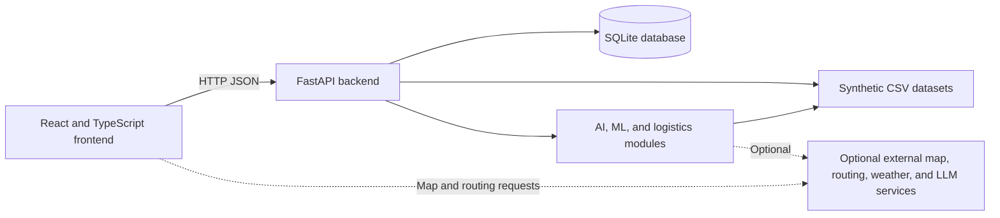

# AgriPreserve Cold-Chain Platform

AgriPreserve is a full-stack demonstration application for agricultural logistics and cold-chain workflows. It provides role-based workspaces for Admin, Farmer, Driver, and Receiver users, with shipment, inventory, sensor, quality-inspection, and international-trade features.

> **Demo limitations:** Bundled sensor readings, shipment locations, and market prices are synthetic. The application is not a live telemetry service, a validated food-safety system, or an official customs calculator.

## Contents

- [Architecture](#architecture)
- [Features and limitations](#features-and-limitations)
- [Project structure](#project-structure)
- [Application workflow](#application-workflow)
- [Backend API](#backend-api)
- [Database and data](#database-and-data)
- [AI and logistics calculations](#ai-and-logistics-calculations)
- [Technology and dependencies](#technology-and-dependencies)
- [Setup and run](#setup-and-run)
- [Testing](#testing)
- [Configuration and integrations](#configuration-and-integrations)
- [Troubleshooting and security](#troubleshooting-and-security)

## Architecture

The frontend is a React and TypeScript single-page application. It calls a FastAPI backend using JSON over HTTP. The backend stores operational data in SQLite and reads the bundled CSVs for initial demo data and analytical features.



The main frontend API wrapper is `src/services/api.ts`. It uses `VITE_API_BASE_URL` when configured; otherwise, it sends requests to the current origin. The backend creates its schema and demo records during application startup.

## Features and limitations

The source code includes:

- Four role-oriented application workspaces: Admin, Farmer, Driver, and Receiver.
- Shipment, storage, inventory, produce, alerts, incidents, quality inspections, orders, and delivery-proof workflows.
- Sensor-reading ingestion and simulation, threshold-based anomaly checks, and shipment risk scoring.
- Demand forecasting based on bundled synthetic market data.
- Local SOP text retrieval and operational Q&A, with an optional external LLM integration.
- International-logistics workflows for quotations, route comparisons, customs estimates, trade documents, landed cost, pickup checks, expenses, and claims.
- Scripts for fetching selected external datasets and weather samples.

These are demo and development workflows. Live sensor hardware, carrier systems, verified market feeds, official customs services, payment gateways, and notification providers are not shown as fully connected production integrations.

Unknown shipment IDs are rejected by inspection, delivery-proof, pickup-verification, and claim creation endpoints, preventing those endpoints from creating orphan records.

## Project structure

Generated folders such as `node_modules/`, `dist/`, virtual environments, and Python cache files are omitted.

```text
project-root/
├── backend/
│   ├── main.py
│   ├── database.py
│   ├── logistics_engine.py
│   ├── ai_services.py
│   ├── import_demo_datasets.py
│   ├── test_platform.py
│   ├── requirements.txt
│   ├── run_backend.bat
│   └── knowledge_base/
├── datasets/
│   ├── synthetic/
│   ├── public_sources/
│   ├── DATA_DICTIONARY.md
│   └── README.md
├── scripts/
├── public/
├── src/
│   ├── components/
│   ├── context/
│   ├── iot/
│   ├── pages/
│   ├── routes/
│   ├── services/
│   ├── types/
│   ├── App.tsx
│   ├── index.css
│   └── main.tsx
├── API_DOCUMENTATION.md
├── package.json
├── package-lock.json
├── eslint.config.js
├── tsconfig*.json
└── index.html
```

### Important files

| File or directory | Responsibility |
|---|---|
| `backend/main.py` | Creates the FastAPI application, configures CORS, defines request models and authentication dependencies, and implements API handlers. |
| `backend/database.py` | Defines SQLite connections and schema initialization, seeds users and demo records, hashes/verifies passwords, and writes audit events. |
| `backend/logistics_engine.py` | Holds Incoterms data, customs and landed-cost calculations, route alternatives, shipment-transition rules, and international-logistics schema logic. |
| `backend/ai_services.py` | Implements anomaly checks, synthetic Isolation Forest training/prediction, demand forecasts, quality heuristics, SOP retrieval, optional LLM requests, and agent recommendations. |
| `backend/test_platform.py` | Runs API verification checks using FastAPI `TestClient`; writes to its configured SQLite database. |
| `backend/import_demo_datasets.py` | Imports the bundled CSV records into SQLite. |
| `backend/knowledge_base/` | Markdown SOP documents available to local retrieval. |
| `src/main.tsx` | Mounts React, the router, authentication context, and global styles. |
| `src/App.tsx` | Maps URLs to public pages and role-specific workspace routes. |
| `src/context/AuthContext.tsx` | Stores the signed-in user/token in browser storage and provides login, logout, and notification helpers. |
| `src/services/api.ts` | Wraps `fetch`, attaches a stored bearer token, defines typed API helpers, and reports unsuccessful HTTP responses as errors. |
| `src/pages/` | Landing, login, and Admin, Farmer, Driver, and Receiver pages. |
| `src/components/` | Shared dashboard layout, navigation, charts, maps, authentication, and UI elements. |
| `src/iot/` | Frontend sensor types, sample readings, simulator/history helpers, alert checks, hooks, and components. |
| `scripts/` | Helpers for selected external dataset and weather retrieval. |

## Application workflow

1. Vite serves the frontend, and `src/main.tsx` mounts the React application.
2. React Router selects a page; workspace routes check the user role.
3. Login submits credentials to `POST /api/auth/login`.
4. The backend verifies the stored password hash and issues a SQLite-backed session token.
5. The frontend stores the user and token in browser storage and adds the token to API requests.
6. FastAPI validates incoming data where request models are used, then handlers query or update SQLite and call AI/logistics helpers as needed.
7. The frontend renders returned JSON data. API errors are thrown by the shared wrapper and handled by page-level error states.

Frontend route guards provide navigation behavior; they do not replace backend authorization. Backend access checks are implemented through user and role dependencies on applicable routes.

## Backend API

The interactive OpenAPI reference is available at `http://127.0.0.1:8000/docs` when the backend is running. It includes route parameters and request schemas.

| Area | Route examples |
|---|---|
| Service status | `GET /`, `GET /api/health`, `GET /api/dashboard/summary` |
| Authentication | `POST /api/auth/login`, `POST /api/auth/logout`, `GET /api/auth/me`, `PUT /api/auth/profile` |
| Users | `GET/POST /api/users`, `PUT/DELETE /api/users/{user_id}` |
| Shipments | `GET/POST /api/shipments`, `GET /api/shipments/{shipment_id}`, `PUT /api/shipments/{shipment_id}/status`, `GET /api/shipments/{shipment_id}/risk` |
| Sensors | `GET /api/sensors/devices`, `POST /api/sensors/readings`, `POST /api/sensors/simulate`, `GET /api/shipments/{shipment_id}/sensors` |
| Operations | Routes for storage, alerts, incidents, produce, inventory, quality inspections, delivery proofs, orders, and market prices |
| AI services | Routes under `/api/ai/` for status, anomaly detection, ML prediction, demand forecasts, SOP search, copilot responses, and agent workflows |
| International logistics | Routes for organizations, farms, fleet, quotations, route optimization, customs, documents, landed costs, pickup checks, expenses, and claims |

The frontend inventory status filter is supported by `GET /api/inventory?status=...`. Incident updates use query parameters matching the backend handler. Customs status updates use the shipment ID and the supported `clearance_status` and `inspector_notes` fields.

## Database and data

The backend uses Python’s built-in `sqlite3` module. The database is stored at `backend/agripreserve.db`; schema creation and seeding run during backend startup. No separate database server is required.

Core tables cover users and sessions, shipments and events, sensor devices and readings, storage, alerts, incidents, produce, inventory and movements, quality inspections, delivery proofs, orders, market prices, notifications, settings, and audit logs. The logistics engine adds tables for organizations, farms, carriers, quotations, shipment legs, customs declarations, trade documents, financial items, pickup verifications, driver expenses, and claims.

The bundled datasets are in `datasets/synthetic/`:

- `shipments.csv`
- `sensor_readings.csv`
- `alerts.csv`
- `storage_facilities.csv`
- `market_prices_demo.csv`
- `produce_quality_labels.csv`

The quality-label CSV contains metadata, not image files. See `datasets/DATA_DICTIONARY.md` for field descriptions. Treat all included observations as synthetic examples, not verified operational records.

## AI and logistics calculations

- **Anomaly checks** compare readings against configured temperature limits and inspect humidity, door state, reefer state, vibration, and recent temperature changes.
- **Isolation Forest** is trained from the bundled sensor CSV; its output is based on synthetic data and is not a validated production model.
- **Demand forecasts** derive illustrative demand from synthetic prices and apply a linear trend with weekly smoothing.
- **Quality evaluation** uses inspector-provided values and heuristics. It is advisory and does not provide validated computer vision or food-safety certification.
- **SOP retrieval** matches terms against local Markdown files; it is not a vector database.
- **LLM answers** can use an optional external API; without credentials, local retrieval-based guidance is used.
- **Customs and landed-cost results** are estimates using configured values, not official government assessments.
- **Route and map views** may use external routing or map services. Sample coordinates are not live GPS.

## Technology and dependencies

- **Frontend:** React, React DOM, TypeScript, React Router, Vite, Tailwind CSS, Lucide React.
- **Frontend development tools:** ESLint 9, TypeScript ESLint, React Hooks and React Refresh plugins.
- **Backend:** Python, FastAPI, Pydantic, Uvicorn, SQLite.
- **Data and ML:** pandas and scikit-learn.
- **Backend verification:** `httpx2` supports the configured FastAPI/Starlette test client.

See `package.json`, `package-lock.json`, and `backend/requirements.txt` for dependency versions and ranges.

## Setup and run

### Prerequisites

- Python 3.11 and the Windows Python Launcher (`py`) for the Windows commands below.
- Node.js and npm.
- Internet access to install dependencies; some map and optional external integrations may also require connectivity.

### Backend — Windows PowerShell

From the project root:

```powershell
Set-Location .\backend
py -3.11 -m venv venv
.\venv\Scripts\python.exe -m pip install -r requirements.txt
.\venv\Scripts\python.exe -m uvicorn main:app --reload --host 127.0.0.1 --port 8000
```

Activation is optional; using the virtual environment’s Python directly avoids PowerShell script execution-policy problems. The API is at `http://127.0.0.1:8000`; Swagger UI is at `http://127.0.0.1:8000/docs`.

### Frontend

Open another PowerShell terminal at the project root:

```powershell
npm install
npm run dev
```

Open the local URL printed by Vite. If setting `VITE_API_BASE_URL`, configure it before starting Vite and restart Vite after changing it.

### Stop services

Press `Ctrl+C` in each terminal running the backend or frontend.

## Testing

The project provides a backend script, not a dedicated frontend test script. The backend verification script initializes and writes demo data to SQLite; run it against a disposable database copy rather than a database containing data you need.

```powershell
.\backend\venv\Scripts\python.exe .\backend\test_platform.py
npm run build
npm run lint
```

The backend suite checks API behavior including login roles, inventory guardrails and filtering, logistics calculations, shipment workflows, and rejection of unknown shipment IDs for related writes. The frontend build runs TypeScript project checks and Vite bundling. Lint may report warnings that do not fail the command.

## Configuration and external integrations

The root `.env.example` includes frontend and backend examples. Source code reads `VITE_API_BASE_URL` in the frontend and `CORS_ORIGINS` in the backend. AI code reads `OPENAI_API_KEY`, `LLM_MODEL`, and `LLM_BASE_URL`, and attempts to load `backend/.env` without overriding existing process variables. The AGMARKNET fetch script reads `DATA_GOV_IN_API_KEY`.

Not every variable shown in example files is consumed by the code. In particular, the backend connection helper selects its SQLite path directly; do not assume `DATABASE_URL` configures that connection. The backend `.env.example` uses `LLM_API_KEY`, whereas the AI source checks `OPENAI_API_KEY`; verify that naming before configuring an LLM.

Helper scripts include:

- `scripts/fetch_open_meteo.py` for weather data samples.
- `scripts/fetch_agmarknet_api.py` for a data.gov.in resource using a supplied resource ID and API key.
- `scripts/download_public_datasets.py --zenodo` for the configured Zenodo record.

External downloads require internet access and may require credentials or source-specific license review. No credentials should be committed to the repository.

## Security and limitations

- Demo accounts and sample data are for local development only; change or disable demo credentials before any shared deployment.
- Keep API keys and passwords out of source control.
- Browser storage contains the frontend session token; this is not a production-grade security design.
- Verify role permissions, CORS configuration, external provider behavior, and database backup needs before deployment.
- AI outputs, customs estimates, forecasts, maps, and quality results should be treated as demonstrations until checked against real, authoritative data and domain review.
